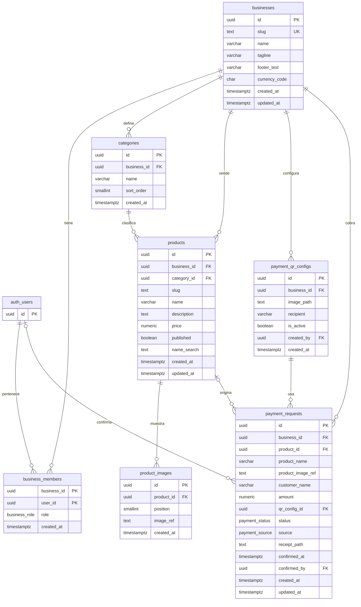

# Diseño de base de datos Supabase — Casa Luma (Catálogo Digital)

Análisis de solo lectura. No se modificó el código fuente y no se creó ningún archivo en `supabase/migrations/`. `AGENTS.md` indica que el esquema de base de datos lo gestiona Lovable, así que el SQL de la sección 8 debe aplicarse desde Lovable o con la aprobación del responsable del proyecto.

Convención de evidencia: `[ruta:símbolo]` apunta al código que justifica la decisión. **(INF)** marca una inferencia que el código no confirma de forma directa, con su justificación.

---

## 1. Resumen ejecutivo

**Qué es la aplicación.** Un catálogo digital de un solo negocio, "Casa Luma", con dos áreas:

- **Catálogo público** (`/`, `/producto/$productId`): búsqueda por nombre, filtro por categoría, detalle con galería de hasta 3 fotos, compartir por enlace o WhatsApp.
- **Administración** (`/admin/*`): CRUD de productos, publicar o despublicar, y un módulo de **pagos por QR** (QR del negocio, solicitudes de pago, comprobante del cliente, confirmación manual).

**Estado de la persistencia.** Todo vive en `localStorage` bajo dos claves, `casa-luma-products-v1` y `casa-luma-payments-v1`. Las imágenes se guardan como data URIs base64. No hay backend, autenticación ni usuarios.

**Diagnóstico.** El modelo de dominio ya está bien definido en esquemas Zod (`catalog/model.ts`, `payments/model.ts`), lo que permite un mapeo directo y fiable a PostgreSQL. Hay cuatro puntos que condicionan el diseño:

1. **No existe identidad.** `/admin` es público. Supabase Auth y RLS no son opcionales, porque hoy cualquiera puede borrar productos o confirmar cobros.
2. **El cliente que paga es anónimo.** Crea solicitudes, ve el QR y adjunta comprobante sin cuenta. Esto no se puede cubrir con RLS por usuario y requiere funciones RPC `SECURITY DEFINER` (sección 7).
3. **Las solicitudes de pago son instantáneas inmutables.** Guardan copia del producto, el importe y el QR del momento (`buildPaymentRequest`). La BD debe conservar esa semántica.
4. **Las imágenes deben pasar de base64 a Supabase Storage.**

**Resultado.** 7 tablas, 3 ENUM, 3 buckets de Storage, 5 funciones RPC y 1 vista. No se crean tablas para clientes, pedidos, carrito, inventario ni métodos de pago, porque el código no los usa.

---

## 2. Inventario de módulos y funcionalidades

| Módulo | Componentes / rutas | Funcionalidad | Datos identificados | Persistencia necesaria |
|---|---|---|---|---|
| Marca y shell | `SiteHeader`, `SiteFooter` (`site-shell.tsx`), `__root.tsx` | Nombre "Casa Luma", lema, textos de pie, metadatos SEO | Nombre, lema "Objetos simples, hechos con intención.", pie "Hecho con calma. Para tu día a día." (hardcodeados) | Sí (INF): datos del negocio hoy son constantes |
| Catálogo público | `CatalogPage`, `ProductCard`, `SearchField`, `EmptyState` (`/`) | Listado de productos publicados, búsqueda sin acentos (máx. 100 caracteres), filtro por categoría, contador | `Product`, categorías | Sí |
| Detalle de producto | `ProductDetailPage` (`/producto/$productId`) | Galería, precio, descripción, compartir, WhatsApp, botón "Pagar con QR" si hay QR y precio > 0 | `Product`, imágenes, existencia de QR activo | Sí |
| Admin productos | `AdminPage` (`/admin`), `AdminTabs` | Listado, búsqueda, filtro de publicación, contadores publicados/no publicados, publicar/despublicar, eliminar con confirmación | `Product` (todos los estados) | Sí |
| Formulario de producto | `ProductFormPage` (`/admin/nuevo`, `/admin/editar/$productId`) | Alta y edición: nombre, descripción, precio, categoría, 1–3 fotos, publicación | `ProductInput`, imágenes subidas | Sí |
| Subida de fotos de producto | `preparePhoto` (`catalog/images.ts`) | JPG/PNG/WebP ≤ 5 MB, redimensiona a 1000 px, recodifica a WebP 0.8 | Binario de imagen | Sí (Storage) |
| Configuración de QR | `QrSettingsPage` (`/admin/pagos/qr`) | Sube o reemplaza imagen QR sin alterar píxeles; destinatario (máx. 100) | `QrConfig` | Sí |
| Solicitudes de pago (admin) | `AdminPaymentsPage`, `PaymentRequestForm` (`/admin/pagos`, `/admin/pagos/nuevo`) | Listado con filtro todos/pendientes/confirmados, contador de pendientes, creación de solicitud (producto, cliente, importe) | `PaymentRequest` | Sí |
| Revisión y confirmación | `ReviewPaymentPage` (`/admin/pagos/revisar/$requestId`) | Ver comprobante, marcar "verifiqué en mi banco", confirmar de forma idempotente | `PaymentRequest.status`, `confirmedAt` | Sí |
| Pago del cliente | `CustomerPaymentPage`, `PaymentRequestForm` en modo cliente (`/producto/$productId/pagar`, `/pago/$requestId`) | Cliente indica su nombre, ve y descarga el QR, adjunta o reemplaza comprobante, compartir por WhatsApp | `PaymentRequest`, comprobante | Sí |
| Compartir | `catalog/share.ts`, `payments/share.ts` | `navigator.share`, copiar enlace, URL `wa.me/?text=` | Ninguno (derivado de IDs) | No |
| Sincronización entre pestañas | `ProductProvider`, `PaymentProvider` (evento `storage`) | Refresca estado | — | Se sustituye por Realtime (opcional) |

---

## 3. Inventario de entidades

### 3.1 Entidades persistentes

| Entidad | Origen en el código | Veredicto |
|---|---|---|
| **Business** (INF) | Constantes "Casa Luma", lema y pie en `site-shell.tsx`, `share.ts`, `qr-settings-page.tsx` (destinatario por defecto) | Tabla `businesses`. Justificación: son datos del negocio hoy hardcodeados, y el prompt describe la app como destinada a "pequeños negocios". Ver decisión D1. |
| **Membership** (INF) | No existe en el código. `/admin` no tiene control de acceso. | Tabla `business_members`. Necesaria para que RLS distinga administradores de público. |
| **Category** | `categories = ["Cerámica","Decoración","Accesorios"] as const` en `catalog/model.ts` | Tabla `categories`. El valor es hoy una constante de código y el enum no permite alta/baja sin desplegar. |
| **Product** | `productSchema`, `initialProducts` | Tabla `products` |
| **ProductImage** | `Product.images: string[]` (1–3, la primera es portada) | Tabla `product_images`. Es una colección ordenada de longitud acotada con referencia a archivo, no un dato escalar. |
| **QrConfig** | `qrConfigSchema` (`image`, `recipient`), singleton en `PaymentState.config` | Tabla `payment_qr_configs`, versionada |
| **PaymentRequest** | `paymentRequestSchema` | Tabla `payment_requests` |

### 3.2 Estructuras que NO se convierten en tabla

| Estructura | Motivo |
|---|---|
| `ProductInput`, `RequestInput` | DTOs de formulario |
| `PaymentState` (`{config, requests}`) | Contenedor de `localStorage`. Se reemplaza por dos consultas. |
| `referencePhotos` (`seed.ts`) | Selector de fotos de demostración. Son assets estáticos de UI, no datos del negocio. |
| Filtros (`query`, `category`, `status`, `filter`) | Estado temporal de UI |
| `PaymentStatus` "Esperando pago / Pendiente de revisión / Confirmado manualmente" | Derivado: `paid` → confirmado; `pending` con `receipt_path` → pendiente de revisión; `pending` sin comprobante → esperando pago |
| Contadores (`published`, `pending`, `filtered.length`) | Calculables con `COUNT` |
| "Disponible" (detalle) | Constante de UI. No existe campo de stock. |
| "1 unidad", "Pago con QR" | Constantes de UI. No existe cantidad ni catálogo de métodos de pago. |
| `confirmRequest(id, bankVerified)` → `bankVerified` | Es un requisito de la operación (siempre `true` si se confirma), no un dato. Se valida en la RPC y no se almacena. |

### 3.3 Cosas que el código NO tiene (y por eso no se diseñan)

Clientes/compradores como entidad, pedidos, carrito, cantidades, inventario, múltiples métodos de pago, teléfono del negocio (WhatsApp usa `wa.me/?text=` sin número), usuarios, historial de estados.

---

## 4. Diccionario de datos

Convención de la columna *Origen*: `Prod.name` significa campo `name` de `Product`.

### 4.1 `businesses` (INF)

| Campo | Tipo | Null | Default | PK/FK | Descripción / origen |
|---|---|---|---|---|---|
| id | uuid | no | `gen_random_uuid()` | PK | |
| slug | text | no | | UNIQUE | Identificador de URL. CHECK `^[a-z0-9]+(-[a-z0-9]+)*$`. |
| name | varchar(100) | no | | | "Casa Luma" (`site-shell.tsx`) |
| tagline | varchar(160) | sí | | | "Objetos simples, hechos con intención." |
| footer_text | varchar(160) | sí | | | "Hecho con calma. Para tu día a día." |
| currency_code | char(3) | no | `'BOB'` | | La UI muestra "Bs" (`formatPrice`). CHECK `^[A-Z]{3}$`. |
| created_at / updated_at | timestamptz | no | `now()` | | |

### 4.2 `business_members` (INF)

| Campo | Tipo | Null | Default | PK/FK | Descripción |
|---|---|---|---|---|---|
| business_id | uuid | no | | PK, FK → businesses.id | |
| user_id | uuid | no | | PK, FK → auth.users.id | |
| role | business_role | no | `'admin'` | | `owner` o `admin` |
| created_at | timestamptz | no | `now()` | | |

### 4.3 `categories`

| Campo | Tipo | Null | Default | PK/FK | Descripción |
|---|---|---|---|---|---|
| id | uuid | no | `gen_random_uuid()` | PK | |
| business_id | uuid | no | | FK → businesses.id | |
| name | varchar(50) | no | | UNIQUE(business_id, name) | Cerámica, Decoración, Accesorios |
| sort_order | smallint | no | `0` | | Orden de las pestañas. En el código es el orden del array. |
| created_at | timestamptz | no | `now()` | | |

También `UNIQUE (id, business_id)`, necesario para la FK compuesta de `products`.

### 4.4 `products`

| Campo | Tipo | Null | Default | PK/FK | Origen / regla |
|---|---|---|---|---|---|
| id | uuid | no | `gen_random_uuid()` | PK | `Prod.id` (hoy `crypto.randomUUID()` o slug en el seed) |
| business_id | uuid | no | | FK → businesses.id | |
| category_id | uuid | no | | FK compuesta (category_id, business_id) → categories | `Prod.category` |
| slug | text | sí | | UNIQUE(business_id, slug) | Conserva ids legibles del seed (`taza-de-ceramica`). INF, ver D2. |
| name | varchar(100) | no | | | CHECK `btrim(name) <> ''`. Zod: `.trim().min(1).max(100)` |
| description | text | no | | | CHECK longitud entre 1 y 1500 tras `btrim`. Contiene saltos de línea (`\n\n`). |
| price | numeric(8,2) | no | | | CHECK `0 <= price <= 999999.99`. Zod: `.min(0)` y precio 0 permitido. El tope se alinea con `requestInputSchema.max(999999.99)`. |
| published | boolean | no | `true` | | `Prod.published`. El formulario inicia en `true`. |
| name_search | text | no | generada | | `f_unaccent(lower(name))`. Replica `normalize()` de `filterProducts`. |
| created_at / updated_at | timestamptz | no | `now()` | | Hoy no existen. Se añaden por convención. |

También `UNIQUE (id, business_id)` para la FK compuesta de `payment_requests`.

### 4.5 `product_images`

| Campo | Tipo | Null | Default | PK/FK | Descripción |
|---|---|---|---|---|---|
| id | uuid | no | `gen_random_uuid()` | PK | |
| product_id | uuid | no | | FK → products.id ON DELETE CASCADE | |
| position | smallint | no | | UNIQUE(product_id, position) | CHECK 0..2. Posición 0 = portada (`product-form.tsx`: "La primera fotografía será la portada"). El límite de 3 se impone con el CHECK. |
| image_ref | text | no | | | Una de dos formas, igual que `imageSchema`: ruta de Storage (`<business_id>/<uuid>.webp`) o URL de asset gestionado `/__l5e/assets-v1/...`. CHECK por regex. |
| created_at | timestamptz | no | `now()` | | |

### 4.6 `payment_qr_configs` (versionada)

| Campo | Tipo | Null | Default | PK/FK | Descripción |
|---|---|---|---|---|---|
| id | uuid | no | `gen_random_uuid()` | PK | |
| business_id | uuid | no | | FK → businesses.id | |
| image_path | text | no | | | Ruta en bucket `payment-qr`. Archivo original, sin recompresión. |
| recipient | varchar(100) | no | | | CHECK `btrim <> ''` |
| is_active | boolean | no | `true` | | Índice único parcial: un solo QR activo por negocio |
| created_by | uuid | sí | | FK → auth.users.id ON DELETE SET NULL | INF |
| created_at | timestamptz | no | `now()` | | |

También `UNIQUE (id, business_id)`.

**Por qué versionada.** El código dice "Las solicitudes existentes conservan su QR" (`qr-settings-page.tsx`) y copia `qr` dentro de cada solicitud. Con una fila nueva por cada cambio de QR y una FK desde la solicitud, la instantánea se obtiene sin duplicar la imagen ni el destinatario.

### 4.7 `payment_requests`

| Campo | Tipo | Null | Default | PK/FK | Origen / regla |
|---|---|---|---|---|---|
| id | uuid | no | `gen_random_uuid()` | PK | `z.string().uuid()` |
| business_id | uuid | no | | FK → businesses.id | |
| product_id | uuid | sí | | FK compuesta (product_id, business_id) → products, ON DELETE SET NULL (product_id) | El producto puede borrarse y la solicitud sobrevive |
| product_name | varchar(100) | no | | | Instantánea (`productName`) |
| product_image_ref | text | no | | | Instantánea de la portada (`productImage`) |
| customer_name | varchar(100) | no | | | `customer`. CHECK `btrim <> ''`. No hay tabla de clientes. |
| amount | numeric(8,2) | no | | | CHECK `0 < amount <= 999999.99`. `numeric(8,2)` impone los dos decimales. |
| qr_config_id | uuid | no | | FK compuesta (qr_config_id, business_id) → payment_qr_configs, ON DELETE RESTRICT | Instantánea del QR |
| status | payment_status | no | `'pending'` | | `pending` / `paid` |
| source | payment_source | no | | | `admin` / `customer`. INF: `buildPaymentRequest` lo recibe pero no lo persiste. Se guarda para auditar qué regla de importe se aplicó. |
| receipt_path | text | sí | | | Ruta en bucket privado `payment-receipts`. Un solo comprobante, reemplazable. |
| confirmed_at | timestamptz | sí | | | Obligatorio si y solo si `status='paid'` |
| confirmed_by | uuid | sí | | FK → auth.users.id ON DELETE SET NULL | INF: hoy no se registra quién confirma |
| created_at / updated_at | timestamptz | no | `now()` | | `createdAt` |

Restricción: `CHECK ((status = 'paid') = (confirmed_at IS NOT NULL))`. Replica la unión discriminada de `paymentRequestSchema`.

---

## 5. Modelo relacional

| # | Origen (FK) | Destino (PK) | Cardinalidad | ON DELETE | ON UPDATE | Justificación |
|---|---|---|---|---|---|---|
| 1 | business_members.business_id | businesses.id | N:1 | CASCADE | NO ACTION | Sin negocio no hay membresías |
| 2 | business_members.user_id | auth.users.id | N:1 | CASCADE | NO ACTION | Al borrar el usuario se pierde su acceso |
| 3 | categories.business_id | businesses.id | N:1 | CASCADE | NO ACTION | |
| 4 | products.business_id | businesses.id | N:1 | CASCADE | NO ACTION | |
| 5 | products (category_id, business_id) | categories (id, business_id) | N:1 | RESTRICT | NO ACTION | No se puede borrar una categoría con productos. La FK compuesta impide usar una categoría de otro negocio. |
| 6 | product_images.product_id | products.id | N:1 | CASCADE | NO ACTION | Las fotos pertenecen al producto |
| 7 | payment_qr_configs.business_id | businesses.id | N:1 | CASCADE | NO ACTION | |
| 8 | payment_qr_configs.created_by | auth.users.id | N:1 | SET NULL | NO ACTION | |
| 9 | payment_requests.business_id | businesses.id | N:1 | CASCADE | NO ACTION | |
| 10 | payment_requests (product_id, business_id) | products (id, business_id) | N:1 opcional | SET NULL (product_id) | NO ACTION | El pago sobrevive al borrado del producto, con su instantánea. **Requiere PostgreSQL 15 o superior.** |
| 11 | payment_requests (qr_config_id, business_id) | payment_qr_configs (id, business_id) | N:1 | RESTRICT | NO ACTION | Un QR usado por una solicitud no puede borrarse |
| 12 | payment_requests.confirmed_by | auth.users.id | N:1 | SET NULL | NO ACTION | |

Todas las relaciones son 1:N. No hay relaciones N:M ni 1:1 en el código, así que no se crean tablas intermedias. `business_members` es la única tabla puente y su relación es N:M entre usuarios y negocios (INF).

---

## 6. Diagrama ER



---

## 7. Arquitectura Supabase

### 7.1 Autenticación y perfiles

- Se usa **Supabase Auth** con correo y contraseña. No se almacenan contraseñas ni datos de autenticación en tablas propias.
- **No se crea tabla `profiles`.** Ninguna pantalla muestra nombre, avatar ni datos de usuario. Si más adelante se añaden, se crea entonces.
- `business_members` enlaza `auth.users` con un negocio y un rol (`owner`/`admin`). El primer `owner` se crea con el seed, porque no existe flujo de alta de negocios en la UI.
- Los clientes que pagan **no se autentican**. Esa es la razón de las RPC siguientes.

### 7.2 Autorización: dos mecanismos

**Datos del negocio (productos, categorías, QR, listado de pagos).** RLS por pertenencia al negocio, con funciones auxiliares `SECURITY DEFINER` (`is_business_member`, `is_business_owner`). Esto evita la recursión de RLS sobre `business_members`.

**Flujo del cliente anónimo.** No se abre ninguna tabla a `anon`. Se exponen cinco funciones RPC con validación en servidor:

| RPC | Quién | Qué hace |
|---|---|---|
| `create_payment_request(product, customer, amount?)` | anon y autenticados | Si el llamador es miembro: `source='admin'`, importe libre > 0. Si no: producto publicado y importe forzado al precio del producto. Congela nombre, portada y QR activo. |
| `get_payment_request(id)` | anon y autenticados | Devuelve una sola solicitud por UUID, con los campos que necesita la pantalla del cliente |
| `attach_receipt(id, path)` | anon y autenticados | Solo si la solicitud está pendiente. La ruta debe empezar por el UUID de la solicitud. |
| `confirm_payment_request(id, bank_verified)` | solo miembros | Exige `bank_verified=true`. Idempotente: si ya está pagada devuelve la fecha original. |
| `set_qr_config(business, path, recipient)` | solo miembros | Desactiva el QR activo e inserta una versión nueva |

`save_product(...)` es una función `SECURITY INVOKER` (la RLS se aplica). Guarda producto y fotos en una sola transacción y exige entre 1 y 3 fotos.

Esto traslada al servidor las reglas que hoy solo viven en el navegador: precio forzado para el cliente (`buildPaymentRequest`), confirmación con verificación bancaria e idempotente, y comprobante que nunca marca el pago como recibido.

### 7.3 Políticas RLS por tabla

| Tabla | RLS | SELECT | INSERT | UPDATE | DELETE | Aislamiento |
|---|---|---|---|---|---|---|
| businesses | sí | público (anon y autenticados) | ninguna (alta por seed/servicio) | owner | ninguna | por negocio |
| business_members | sí | el propio usuario u owner del negocio | owner | owner | owner | por negocio |
| categories | sí | público | miembros | miembros | miembros | por negocio |
| products | sí | `published` o miembro | miembros | miembros | miembros | por negocio |
| product_images | sí | hereda de `products` | miembros | miembros | miembros | por negocio |
| payment_qr_configs | sí | miembros | ninguna (solo RPC) | ninguna (solo RPC) | ninguna | por negocio |
| payment_requests | sí | miembros | ninguna (solo RPC) | ninguna (solo RPC) | ninguna | por negocio |

Un cliente anónimo nunca puede listar `payment_requests` ni `payment_qr_configs`. Solo accede a una solicitud conociendo su UUID, a través de `get_payment_request`.

### 7.4 Storage

| Bucket | Público | Límite / MIME | Ruta | Escritura |
|---|---|---|---|---|
| `product-images` | sí | 5 MB, webp/png/jpeg | `<business_id>/<uuid>.webp` | miembros del negocio de la primera carpeta |
| `payment-qr` | sí | 5 MB, webp/png/jpeg | `<business_id>/<uuid>.<ext>` | miembros |
| `payment-receipts` | **no** | 5 MB, webp/png/jpeg | `<request_id>/<uuid>.<ext>` | cualquiera, solo si la solicitud existe y está pendiente |

El QR va en un bucket público porque el cliente debe verlo y descargarlo. Las rutas llevan UUID aleatorio.

Los comprobantes son privados. Los miembros los leen mediante URL firmada.

El cliente redimensiona la foto de producto en el navegador (`preparePhoto`). El bucket impone tipo y tamaño en el servidor, que es lo que la validación de Zod no puede garantizar.

### 7.5 Triggers y funciones

- `set_updated_at` en `businesses`, `products`, `payment_requests`.
- `payment_requests_guard`: impide modificar importe, cliente, instantáneas, QR y origen; impide revertir o alterar un pago `paid`. Permite que la FK ponga `product_id` en `NULL`.
- `f_unaccent`: envoltorio inmutable de `unaccent` para la columna generada de búsqueda.

### 7.6 Lo que se evalúa y se descarta

| Elemento | Decisión |
|---|---|
| Soft delete | No. La UI dice "Esta acción no se puede deshacer". Las solicitudes conservan su instantánea. |
| Tabla de auditoría | No. Solo existe `confirmedAt`; basta `confirmed_at` y `confirmed_by`. |
| Realtime | Opcional, solo para `payment_requests`. Reemplaza el evento `storage` entre pestañas y deja al admin ver solicitudes creadas por clientes desde otros dispositivos. |
| Vista SQL | Una: `catalog_products`, que une producto, categoría e imágenes ordenadas, para evitar N+1. Usa `security_invoker`, por lo que respeta RLS. |

---

## 8. Script SQL completo

Ordenado por dependencias. Sin `DROP`. Requiere PostgreSQL 15 o superior (`ON DELETE SET NULL (columna)`). Verifica la versión en *Database → Settings* antes de ejecutar.

```sql
-- =====================================================================
-- Casa Luma · Catálogo Digital · Esquema Supabase
-- Ejecutar en el SQL Editor de Supabase (PostgreSQL 15+)
-- =====================================================================

-- ---------- 0. Extensiones ----------
create extension if not exists pg_trgm  with schema extensions;
create extension if not exists unaccent with schema extensions;

-- ---------- 1. Tipos ENUM ----------
create type public.business_role   as enum ('owner', 'admin');
create type public.payment_status  as enum ('pending', 'paid');
create type public.payment_source  as enum ('admin', 'customer');

-- ---------- 2. Funciones auxiliares independientes ----------
create or replace function public.set_updated_at()
returns trigger
language plpgsql
set search_path = ''
as $$
begin
  new.updated_at = now();
  return new;
end;
$$;

-- Envoltorio inmutable para poder usar unaccent en columnas generadas e índices.
create or replace function public.f_unaccent(text)
returns text
language sql
immutable
parallel safe
strict
set search_path = ''
as $$ select extensions.unaccent('extensions.unaccent'::regdictionary, $1) $$;

-- ---------- 3. Tablas ----------
create table public.businesses (
  id            uuid primary key default gen_random_uuid(),
  slug          text not null unique
                check (slug ~ '^[a-z0-9]+(-[a-z0-9]+)*$'),
  name          varchar(100) not null check (btrim(name) <> ''),
  tagline       varchar(160),
  footer_text   varchar(160),
  currency_code char(3) not null default 'BOB' check (currency_code ~ '^[A-Z]{3}$'),
  created_at    timestamptz not null default now(),
  updated_at    timestamptz not null default now()
);

create table public.business_members (
  business_id uuid not null references public.businesses(id) on delete cascade,
  user_id     uuid not null references auth.users(id)        on delete cascade,
  role        public.business_role not null default 'admin',
  created_at  timestamptz not null default now(),
  primary key (business_id, user_id)
);
create index business_members_user_idx on public.business_members (user_id);

create table public.categories (
  id          uuid primary key default gen_random_uuid(),
  business_id uuid not null references public.businesses(id) on delete cascade,
  name        varchar(50) not null check (btrim(name) <> ''),
  sort_order  smallint not null default 0,
  created_at  timestamptz not null default now(),
  unique (business_id, name),
  unique (id, business_id)
);

create table public.products (
  id          uuid primary key default gen_random_uuid(),
  business_id uuid not null references public.businesses(id) on delete cascade,
  category_id uuid not null,
  slug        text check (slug ~ '^[a-z0-9]+(-[a-z0-9]+)*$'),
  name        varchar(100) not null check (btrim(name) <> ''),
  description text not null
              check (char_length(btrim(description)) between 1 and 1500),
  price       numeric(8,2) not null check (price >= 0 and price <= 999999.99),
  published   boolean not null default true,
  name_search text generated always as (public.f_unaccent(lower(name))) stored,
  created_at  timestamptz not null default now(),
  updated_at  timestamptz not null default now(),
  unique (business_id, slug),
  unique (id, business_id),
  foreign key (category_id, business_id)
    references public.categories (id, business_id) on delete restrict
);
create index products_business_pub_cat_idx
  on public.products (business_id, published, category_id);
create index products_category_idx on public.products (category_id, business_id);
create index products_name_search_trgm_idx
  on public.products using gin (name_search extensions.gin_trgm_ops);

create table public.product_images (
  id         uuid primary key default gen_random_uuid(),
  product_id uuid not null references public.products(id) on delete cascade,
  position   smallint not null check (position between 0 and 2),
  image_ref  text not null check (
       image_ref ~ '^/__l5e/assets-v1/[a-zA-Z0-9/-]+\.(webp|png|jpg|jpeg)$'
    or image_ref ~ '^[0-9a-f-]{36}/[A-Za-z0-9._-]+\.(webp|png|jpg|jpeg)$'
  ),
  created_at timestamptz not null default now(),
  unique (product_id, position)
);

create table public.payment_qr_configs (
  id          uuid primary key default gen_random_uuid(),
  business_id uuid not null references public.businesses(id) on delete cascade,
  image_path  text not null
              check (image_path ~ '^[0-9a-f-]{36}/[A-Za-z0-9._-]+\.(webp|png|jpg|jpeg)$'),
  recipient   varchar(100) not null check (btrim(recipient) <> ''),
  is_active   boolean not null default true,
  created_by  uuid references auth.users(id) on delete set null,
  created_at  timestamptz not null default now(),
  unique (id, business_id)
);
-- Un único QR activo por negocio.
create unique index payment_qr_one_active_idx
  on public.payment_qr_configs (business_id) where is_active;

create table public.payment_requests (
  id                uuid primary key default gen_random_uuid(),
  business_id       uuid not null references public.businesses(id) on delete cascade,
  product_id        uuid,
  product_name      varchar(100) not null check (btrim(product_name) <> ''),
  product_image_ref text not null check (
       product_image_ref ~ '^/__l5e/assets-v1/[a-zA-Z0-9/-]+\.(webp|png|jpg|jpeg)$'
    or product_image_ref ~ '^[0-9a-f-]{36}/[A-Za-z0-9._-]+\.(webp|png|jpg|jpeg)$'
  ),
  customer_name     varchar(100) not null check (btrim(customer_name) <> ''),
  amount            numeric(8,2) not null check (amount > 0 and amount <= 999999.99),
  qr_config_id      uuid not null,
  status            public.payment_status not null default 'pending',
  source            public.payment_source not null,
  receipt_path      text check (
    receipt_path ~ '^[0-9a-f-]{36}/[A-Za-z0-9._-]+\.(webp|png|jpg|jpeg)$'
  ),
  confirmed_at      timestamptz,
  confirmed_by      uuid references auth.users(id) on delete set null,
  created_at        timestamptz not null default now(),
  updated_at        timestamptz not null default now(),
  -- Replica la unión discriminada de paymentRequestSchema.
  check ((status = 'paid') = (confirmed_at is not null)),
  -- El producto puede borrarse: solo product_id pasa a NULL (PostgreSQL 15+).
  foreign key (product_id, business_id)
    references public.products (id, business_id) on delete set null (product_id),
  foreign key (qr_config_id, business_id)
    references public.payment_qr_configs (id, business_id) on delete restrict
);
create index payment_requests_list_idx
  on public.payment_requests (business_id, status, created_at desc);
create index payment_requests_product_idx on public.payment_requests (product_id);
create index payment_requests_qr_idx on public.payment_requests (qr_config_id, business_id);
create index payment_requests_confirmed_by_idx on public.payment_requests (confirmed_by);

-- ---------- 4. Triggers ----------
create trigger businesses_updated_at before update on public.businesses
  for each row execute function public.set_updated_at();
create trigger products_updated_at before update on public.products
  for each row execute function public.set_updated_at();
create trigger payment_requests_updated_at before update on public.payment_requests
  for each row execute function public.set_updated_at();

create or replace function public.payment_requests_guard()
returns trigger
language plpgsql
set search_path = ''
as $$
begin
  if new.id           is distinct from old.id
  or new.business_id  is distinct from old.business_id
  or new.qr_config_id is distinct from old.qr_config_id
  or new.customer_name is distinct from old.customer_name
  or new.product_name is distinct from old.product_name
  or new.product_image_ref is distinct from old.product_image_ref
  or new.amount       is distinct from old.amount
  or new.source       is distinct from old.source
  or new.created_at   is distinct from old.created_at then
    raise exception 'Los datos de una solicitud de pago no se pueden modificar.'
      using errcode = '23514';
  end if;

  -- product_id solo puede pasar a NULL (borrado del producto).
  if new.product_id is distinct from old.product_id and new.product_id is not null then
    raise exception 'El producto de una solicitud no se puede cambiar.' using errcode = '23514';
  end if;

  if old.status = 'paid' and (
       new.status       is distinct from old.status
    or new.confirmed_at is distinct from old.confirmed_at
    or new.receipt_path is distinct from old.receipt_path
    or (new.confirmed_by is distinct from old.confirmed_by and new.confirmed_by is not null)
  ) then
    raise exception 'Este pago ya fue confirmado.' using errcode = '23514';
  end if;
  return new;
end;
$$;

create trigger payment_requests_guard_trg before update on public.payment_requests
  for each row execute function public.payment_requests_guard();

-- ---------- 5. Funciones de autorización (dependen de las tablas) ----------
create or replace function public.is_business_member(p_business uuid)
returns boolean
language sql stable security definer
set search_path = ''
as $$
  select exists (
    select 1 from public.business_members m
    where m.business_id = p_business and m.user_id = (select auth.uid())
  )
$$;

create or replace function public.is_business_owner(p_business uuid)
returns boolean
language sql stable security definer
set search_path = ''
as $$
  select exists (
    select 1 from public.business_members m
    where m.business_id = p_business and m.user_id = (select auth.uid())
      and m.role = 'owner'
  )
$$;

-- Primera carpeta de una ruta de Storage como uuid (NULL si no es válida).
create or replace function public.path_uuid(p_name text)
returns uuid
language plpgsql immutable
set search_path = ''
as $$
begin
  return (string_to_array(p_name, '/'))[1]::uuid;
exception when others then
  return null;
end;
$$;

-- ¿Existe una solicitud pendiente con ese id? (para subir comprobantes)
create or replace function public.pending_request_exists(p_id uuid)
returns boolean
language sql stable security definer
set search_path = ''
as $$ select exists (select 1 from public.payment_requests r where r.id = p_id and r.status = 'pending') $$;

create or replace function public.request_exists(p_id uuid)
returns boolean
language sql stable security definer
set search_path = ''
as $$ select exists (select 1 from public.payment_requests r where r.id = p_id) $$;

create or replace function public.is_request_member(p_id uuid)
returns boolean
language sql stable security definer
set search_path = ''
as $$
  select exists (
    select 1 from public.payment_requests r
    where r.id = p_id and public.is_business_member(r.business_id)
  )
$$;

-- ---------- 6. Funciones de negocio (RPC) ----------
create or replace function public.create_payment_request(
  p_product_id uuid,
  p_customer   text,
  p_amount     numeric default null
) returns uuid
language plpgsql security definer
set search_path = ''
as $$
declare
  v_product  record;
  v_qr_id    uuid;
  v_cover    text;
  v_customer text := btrim(coalesce(p_customer, ''));
  v_amount   numeric;
  v_source   public.payment_source;
  v_id       uuid;
begin
  select p.id, p.business_id, p.name, p.price, p.published
    into v_product
    from public.products p where p.id = p_product_id;
  if not found then
    raise exception 'Este producto no está disponible.' using errcode = 'P0001';
  end if;

  if char_length(v_customer) not between 1 and 100 then
    raise exception 'El nombre del cliente es obligatorio.' using errcode = 'P0001';
  end if;

  if public.is_business_member(v_product.business_id) then
    v_source := 'admin';
    v_amount := coalesce(p_amount, v_product.price);
  else
    if not v_product.published then
      raise exception 'Este producto no está disponible.' using errcode = 'P0001';
    end if;
    v_source := 'customer';
    -- Un cliente paga el precio del producto, nunca un importe enviado por el navegador.
    if p_amount is not null and p_amount <> v_product.price then
      raise exception 'El importe debe coincidir con el precio del producto.' using errcode = 'P0001';
    end if;
    v_amount := v_product.price;
  end if;

  if v_amount is null or v_amount <= 0 then
    raise exception 'El importe debe ser mayor que cero.' using errcode = 'P0001';
  end if;
  if v_amount > 999999.99 then
    raise exception 'El importe es demasiado alto.' using errcode = 'P0001';
  end if;
  if v_amount <> round(v_amount, 2) then
    raise exception 'Usa un máximo de dos decimales.' using errcode = 'P0001';
  end if;

  select q.id into v_qr_id
    from public.payment_qr_configs q
    where q.business_id = v_product.business_id and q.is_active;
  if v_qr_id is null then
    raise exception 'El QR de pago no está configurado.' using errcode = 'P0001';
  end if;

  select i.image_ref into v_cover
    from public.product_images i
    where i.product_id = v_product.id and i.position = 0;
  if v_cover is null then
    raise exception 'Este producto no tiene fotografía.' using errcode = 'P0001';
  end if;

  insert into public.payment_requests
    (business_id, product_id, product_name, product_image_ref,
     customer_name, amount, qr_config_id, source)
  values
    (v_product.business_id, v_product.id, v_product.name, v_cover,
     v_customer, v_amount, v_qr_id, v_source)
  returning id into v_id;
  return v_id;
end;
$$;

create or replace function public.get_payment_request(p_id uuid)
returns table (
  id uuid, business_name text, customer_name text, product_name text,
  product_image_ref text, amount numeric, status public.payment_status,
  created_at timestamptz, confirmed_at timestamptz, receipt_path text,
  qr_image_path text, qr_recipient text
)
language sql stable security definer
set search_path = ''
as $$
  select r.id, b.name::text, r.customer_name::text, r.product_name::text,
         r.product_image_ref, r.amount, r.status, r.created_at, r.confirmed_at,
         r.receipt_path, q.image_path, q.recipient::text
  from public.payment_requests r
  join public.businesses b on b.id = r.business_id
  join public.payment_qr_configs q on q.id = r.qr_config_id
  where r.id = p_id
$$;

create or replace function public.attach_receipt(p_id uuid, p_path text)
returns void
language plpgsql security definer
set search_path = ''
as $$
declare v_status public.payment_status;
begin
  select status into v_status from public.payment_requests where id = p_id;
  if not found then
    raise exception 'La solicitud ya no existe.' using errcode = 'P0001';
  end if;
  if v_status = 'paid' then
    raise exception 'Este pago ya fue confirmado.' using errcode = 'P0001';
  end if;
  if p_path is null or split_part(p_path, '/', 1) <> p_id::text then
    raise exception 'Ruta de comprobante no válida.' using errcode = 'P0001';
  end if;
  -- Un comprobante nunca marca el pago como recibido.
  update public.payment_requests set receipt_path = p_path where id = p_id;
end;
$$;

create or replace function public.confirm_payment_request(p_id uuid, p_bank_verified boolean)
returns timestamptz
language plpgsql security definer
set search_path = ''
as $$
declare v_req record; v_now timestamptz := now();
begin
  select business_id, status, confirmed_at into v_req
    from public.payment_requests where id = p_id for update;
  if not found then
    raise exception 'La solicitud ya no existe.' using errcode = 'P0001';
  end if;
  if not public.is_business_member(v_req.business_id) then
    raise exception 'No autorizado.' using errcode = '42501';
  end if;
  if v_req.status = 'paid' then
    return v_req.confirmed_at;               -- idempotente: conserva la fecha original
  end if;
  if p_bank_verified is distinct from true then
    raise exception 'Confirma que verificaste el ingreso en tu banco.' using errcode = 'P0001';
  end if;
  update public.payment_requests
     set status = 'paid', confirmed_at = v_now, confirmed_by = (select auth.uid())
   where id = p_id;
  return v_now;
end;
$$;

create or replace function public.set_qr_config(
  p_business uuid, p_image_path text, p_recipient text
) returns uuid
language plpgsql security definer
set search_path = ''
as $$
declare v_id uuid;
begin
  if not public.is_business_member(p_business) then
    raise exception 'No autorizado.' using errcode = '42501';
  end if;
  update public.payment_qr_configs set is_active = false
   where business_id = p_business and is_active;
  insert into public.payment_qr_configs (business_id, image_path, recipient, created_by)
  values (p_business, p_image_path, btrim(p_recipient), (select auth.uid()))
  returning id into v_id;
  return v_id;
end;
$$;

-- Guardado atómico de producto + fotos. SECURITY INVOKER: la RLS se aplica.
create or replace function public.save_product(
  p_business    uuid,
  p_id          uuid,
  p_name        text,
  p_description text,
  p_price       numeric,
  p_category    uuid,
  p_published   boolean,
  p_images      text[]
) returns uuid
language plpgsql security invoker
set search_path = ''
as $$
declare v_id uuid;
begin
  if coalesce(array_length(p_images, 1), 0) not between 1 and 3 then
    raise exception 'Agrega entre 1 y 3 fotografías.' using errcode = 'P0001';
  end if;

  if p_id is null then
    insert into public.products
      (business_id, category_id, name, description, price, published)
    values
      (p_business, p_category, btrim(p_name), btrim(p_description), p_price, p_published)
    returning id into v_id;
  else
    update public.products
       set category_id = p_category, name = btrim(p_name),
           description = btrim(p_description), price = p_price, published = p_published
     where id = p_id and business_id = p_business
    returning id into v_id;
    if v_id is null then
      raise exception 'Este producto ya no existe.' using errcode = 'P0001';
    end if;
  end if;

  delete from public.product_images where product_id = v_id;
  insert into public.product_images (product_id, position, image_ref)
  select v_id, (t.ord - 1)::smallint, t.img
    from unnest(p_images) with ordinality as t(img, ord);
  return v_id;
end;
$$;

-- Permisos de ejecución: por defecto PUBLIC puede ejecutar; se restringe.
revoke execute on function
  public.create_payment_request(uuid, text, numeric),
  public.get_payment_request(uuid),
  public.attach_receipt(uuid, text),
  public.confirm_payment_request(uuid, boolean),
  public.set_qr_config(uuid, text, text),
  public.save_product(uuid, uuid, text, text, numeric, uuid, boolean, text[])
from public;

grant execute on function public.create_payment_request(uuid, text, numeric) to anon, authenticated;
grant execute on function public.get_payment_request(uuid)                    to anon, authenticated;
grant execute on function public.attach_receipt(uuid, text)                   to anon, authenticated;
grant execute on function public.confirm_payment_request(uuid, boolean)       to authenticated;
grant execute on function public.set_qr_config(uuid, text, text)              to authenticated;
grant execute on function public.save_product(uuid, uuid, text, text, numeric, uuid, boolean, text[]) to authenticated;

-- ---------- 7. Vista ----------
create view public.catalog_products with (security_invoker = true) as
select p.id, p.business_id, p.slug, p.name, p.name_search, p.description, p.price,
       p.published, p.category_id, c.name as category_name, c.sort_order as category_order,
       coalesce(
         (select array_agg(i.image_ref order by i.position)
            from public.product_images i where i.product_id = p.id),
         '{}'::text[]
       ) as images,
       p.created_at, p.updated_at
from public.products p
join public.categories c on c.id = p.category_id and c.business_id = p.business_id;

grant select on public.catalog_products to anon, authenticated;

-- ---------- 8. Row Level Security ----------
alter table public.businesses         enable row level security;
alter table public.business_members   enable row level security;
alter table public.categories         enable row level security;
alter table public.products           enable row level security;
alter table public.product_images     enable row level security;
alter table public.payment_qr_configs enable row level security;
alter table public.payment_requests   enable row level security;

-- Defensa en profundidad: el anónimo no toca estas tablas ni por error.
revoke all on public.payment_requests, public.payment_qr_configs, public.business_members from anon;

-- businesses
create policy businesses_select_public on public.businesses
  for select to anon, authenticated using (true);
create policy businesses_update_owner on public.businesses
  for update to authenticated
  using (public.is_business_owner(id)) with check (public.is_business_owner(id));

-- business_members
create policy members_select on public.business_members
  for select to authenticated
  using (user_id = (select auth.uid()) or public.is_business_owner(business_id));
create policy members_insert_owner on public.business_members
  for insert to authenticated with check (public.is_business_owner(business_id));
create policy members_update_owner on public.business_members
  for update to authenticated
  using (public.is_business_owner(business_id)) with check (public.is_business_owner(business_id));
create policy members_delete_owner on public.business_members
  for delete to authenticated using (public.is_business_owner(business_id));

-- categories
create policy categories_select_public on public.categories
  for select to anon, authenticated using (true);
create policy categories_insert_member on public.categories
  for insert to authenticated with check (public.is_business_member(business_id));
create policy categories_update_member on public.categories
  for update to authenticated
  using (public.is_business_member(business_id)) with check (public.is_business_member(business_id));
create policy categories_delete_member on public.categories
  for delete to authenticated using (public.is_business_member(business_id));

-- products
create policy products_select on public.products
  for select to anon, authenticated
  using (published or public.is_business_member(business_id));
create policy products_insert_member on public.products
  for insert to authenticated with check (public.is_business_member(business_id));
create policy products_update_member on public.products
  for update to authenticated
  using (public.is_business_member(business_id)) with check (public.is_business_member(business_id));
create policy products_delete_member on public.products
  for delete to authenticated using (public.is_business_member(business_id));

-- product_images (hereda la visibilidad de products)
create policy product_images_select on public.product_images
  for select to anon, authenticated
  using (exists (select 1 from public.products p where p.id = product_images.product_id));
create policy product_images_insert_member on public.product_images
  for insert to authenticated
  with check (exists (select 1 from public.products p
                      where p.id = product_images.product_id
                        and public.is_business_member(p.business_id)));
create policy product_images_update_member on public.product_images
  for update to authenticated
  using (exists (select 1 from public.products p
                 where p.id = product_images.product_id
                   and public.is_business_member(p.business_id)))
  with check (exists (select 1 from public.products p
                      where p.id = product_images.product_id
                        and public.is_business_member(p.business_id)));
create policy product_images_delete_member on public.product_images
  for delete to authenticated
  using (exists (select 1 from public.products p
                 where p.id = product_images.product_id
                   and public.is_business_member(p.business_id)));

-- payment_qr_configs y payment_requests: solo lectura para miembros; escritura solo por RPC
create policy qr_configs_select_member on public.payment_qr_configs
  for select to authenticated using (public.is_business_member(business_id));
create policy payment_requests_select_member on public.payment_requests
  for select to authenticated using (public.is_business_member(business_id));

-- ---------- 9. Storage ----------
insert into storage.buckets (id, name, public, file_size_limit, allowed_mime_types) values
  ('product-images',   'product-images',   true,  5242880, array['image/webp','image/png','image/jpeg']),
  ('payment-qr',       'payment-qr',       true,  5242880, array['image/webp','image/png','image/jpeg']),
  ('payment-receipts', 'payment-receipts', false, 5242880, array['image/webp','image/png','image/jpeg'])
on conflict (id) do nothing;

-- Imágenes de producto y QR: carpeta raíz = business_id, escritura solo para miembros
create policy storage_business_assets_select on storage.objects
  for select to authenticated
  using (bucket_id in ('product-images', 'payment-qr')
         and public.is_business_member(public.path_uuid(name)));
create policy storage_business_assets_insert on storage.objects
  for insert to authenticated
  with check (bucket_id in ('product-images', 'payment-qr')
              and public.is_business_member(public.path_uuid(name)));
create policy storage_business_assets_update on storage.objects
  for update to authenticated
  using (bucket_id in ('product-images', 'payment-qr')
         and public.is_business_member(public.path_uuid(name)))
  with check (bucket_id in ('product-images', 'payment-qr')
              and public.is_business_member(public.path_uuid(name)));
create policy storage_business_assets_delete on storage.objects
  for delete to authenticated
  using (bucket_id in ('product-images', 'payment-qr')
         and public.is_business_member(public.path_uuid(name)));

-- Comprobantes: carpeta raíz = request_id.
-- Subir: cualquiera, solo si la solicitud existe y está pendiente.
create policy storage_receipts_insert on storage.objects
  for insert to anon, authenticated
  with check (bucket_id = 'payment-receipts'
              and public.pending_request_exists(public.path_uuid(name)));
-- Leer: quien conoce el id de la solicitud (enlace de pago) o un miembro del negocio.
create policy storage_receipts_select on storage.objects
  for select to anon, authenticated
  using (bucket_id = 'payment-receipts'
         and public.request_exists(public.path_uuid(name)));

-- ---------- 10. Realtime (opcional) ----------
-- alter publication supabase_realtime add table public.payment_requests;
```

---

## 9. Matriz de trazabilidad UI → BD

| Módulo UI | Componente React | Entidad | Tabla / objeto | Campos usados | Operación |
|---|---|---|---|---|---|
| Marca | `SiteHeader`, `SiteFooter` | Business | businesses | name, tagline, footer_text | SELECT (1 fila) |
| Catálogo | `CatalogPage` | Product, Category | `catalog_products` | id, name, name_search, price, images, category_name, published | SELECT con filtro `published`, `category_id`, `name_search ilike`, orden. Paginación futura con `range()`. |
| Catálogo | `CatalogPage` (pestañas) | Category | categories | name, sort_order | SELECT ordenado |
| Catálogo | `ProductCard` | Product | `catalog_products` | name, price, images[0], description (primera línea) | SELECT |
| Detalle | `ProductDetailPage` | Product | `catalog_products` | todos | SELECT por `id` (o `slug`) con `published=true` |
| Detalle | `ProductDetailPage` (botón QR) | QrConfig | `payment_qr_configs` | existencia de QR activo | **Hueco:** el cliente anónimo no puede leer la tabla. Ver hallazgo H7. |
| Admin productos | `AdminPage` | Product | `catalog_products` | todos, sin filtro de publicación | SELECT (RLS: miembro) |
| Admin productos | `AdminPage` (contadores) | Product | products | `count(*) filter (where published)` | Agregación |
| Admin productos | `AdminPage` (interruptor) | Product | products | published | UPDATE |
| Admin productos | `AdminPage` (eliminar) | Product | products | id | DELETE (cascada a product_images) |
| Formulario producto | `ProductForm` | Product, ProductImage | `save_product` → products, product_images | name, description, price, category_id, published, images[] | INSERT/UPDATE + reemplazo de fotos, atómico |
| Formulario producto | `preparePhoto` | ProductImage | Storage `product-images` | archivo | Upload |
| Formulario producto | `referencePhotos` | — | assets estáticos | — | Sin tabla |
| QR | `QrSettingsPage` | QrConfig | `set_qr_config` → payment_qr_configs, Storage `payment-qr` | image_path, recipient | RPC (desactiva anterior, inserta nuevo) |
| QR | `QrSettingsPage` (carga) | QrConfig | payment_qr_configs | image_path, recipient | SELECT activo |
| Pagos admin | `AdminPaymentsPage` | PaymentRequest | payment_requests | todos los campos, filtro `status` | SELECT, `count where status='pending'` |
| Pagos admin | `PaymentRequestForm` (modo admin) | PaymentRequest | `create_payment_request` | product_id, customer_name, amount | RPC |
| Pagos admin | `ReviewPaymentPage` | PaymentRequest | payment_requests + Storage `payment-receipts` | customer_name, amount, product_*, receipt_path, status | SELECT + URL firmada |
| Pagos admin | `ReviewPaymentPage` (confirmar) | PaymentRequest | `confirm_payment_request` | id, bank_verified | RPC |
| Pago cliente | `PaymentRequestForm` (modo cliente) | PaymentRequest | `create_payment_request` | product_id, customer_name | RPC (importe forzado en servidor) |
| Pago cliente | `CustomerPaymentPage` | PaymentRequest | `get_payment_request` | todos los campos devueltos | RPC (lectura por UUID) |
| Pago cliente | `CustomerPaymentPage` (comprobante) | PaymentRequest | Storage `payment-receipts` + `attach_receipt` | receipt_path | Upload + RPC |
| Pago cliente | `QrPreview`, `downloadQr` | QrConfig | Storage `payment-qr` (público) | image_path | Lectura de archivo |
| Compartir | `share.ts` | — | — | ids | Sin acceso a BD |
| Metadatos SEO | `routes/producto.$productId.tsx` | Product | `catalog_products` | name, description | Hoy usa `initialProducts` en `head()`. Con BD: SELECT en el loader. |

### Brechas detectadas

**Campos de UI sin representación en BD:** ninguno de los campos de formulario o listado queda sin columna.

**Tablas sin uso directo en la UI actual:** `business_members` y `businesses.currency_code`. El primero existe solo para RLS y el segundo respalda el formato de moneda, que hoy es una constante.

**Datos hardcodeados que deberían persistirse:** nombre, lema y pie del negocio; las tres categorías; destinatario por defecto "Casa Luma" (`qr-settings-page.tsx`).

**Datos calculables, que no se persisten:** contadores, estado visual del pago, URL de producto o de pago, etiqueta "Disponible".

**Funcionalidades que requerirían nuevas entidades si se piden:** cantidad por solicitud (hoy "1 unidad" fijo), stock, teléfono del negocio, otros métodos de pago.

---

## 10. Datos de prueba

Reproducen `initialProducts` (`seed.ts`) con los precios y descripciones actuales. Los 4 productos usan las URLs de asset existentes. En producción esas imágenes deben subirse a Storage (hallazgo H4).

Los mocks **no incluyen** solicitudes de pago ni QR: `emptyPaymentState` es `{config: null, requests: []}`. Los valores `data:image/png;base64,aGVsbG8=` solo existen en los tests y no son imágenes reales. Por eso no se inserta ninguna fila de pagos.

```sql
-- UUID fijos para que el seed sea reproducible y las FK sean legibles.
insert into public.businesses (id, slug, name, tagline, footer_text, currency_code) values
  ('00000000-0000-4000-8000-000000000001', 'casa-luma', 'Casa Luma',
   'Objetos simples, hechos con intención.', 'Hecho con calma. Para tu día a día.', 'BOB');

insert into public.categories (id, business_id, name, sort_order) values
  ('00000000-0000-4000-8000-0000000000c1', '00000000-0000-4000-8000-000000000001', 'Cerámica',    1),
  ('00000000-0000-4000-8000-0000000000c2', '00000000-0000-4000-8000-000000000001', 'Decoración',  2),
  ('00000000-0000-4000-8000-0000000000c3', '00000000-0000-4000-8000-000000000001', 'Accesorios',  3);

insert into public.products (id, business_id, category_id, slug, name, description, price, published) values
 ('00000000-0000-4000-8000-0000000000a1', '00000000-0000-4000-8000-000000000001',
  '00000000-0000-4000-8000-0000000000c1', 'taza-de-ceramica', 'Taza de cerámica',
  E'Un pequeño momento de calma para tu café de cada día.\n\nCerámica esmaltada a mano con un asa cómoda. Capacidad de 300 ml. Apta para lavavajillas. Cada pieza tiene sus propias variaciones sutiles, tan únicas como los momentos que compartes con ella.',
  49, true),
 ('00000000-0000-4000-8000-0000000000a2', '00000000-0000-4000-8000-000000000001',
  '00000000-0000-4000-8000-0000000000c2', 'jarron-de-terracota', 'Jarrón de terracota',
  E'Un toque de calidez para tus rincones favoritos.\n\nPequeño jarrón de terracota elaborado a mano, con una textura natural y un delicado borde ondulado. Ideal para una flor, una rama o simplemente para disfrutarlo tal como es.',
  79, true),
 ('00000000-0000-4000-8000-0000000000a3', '00000000-0000-4000-8000-000000000001',
  '00000000-0000-4000-8000-0000000000c3', 'bolso-de-algodon', 'Bolso de algodón',
  E'Tu compañero para las pequeñas aventuras de cada día.\n\nBolso de algodón natural, ligero y resistente, con asas largas para llevarlo cómodamente al hombro. Una pieza sencilla y reutilizable para ir al mercado o pasear por la ciudad.',
  39, true),
 ('00000000-0000-4000-8000-0000000000a4', '00000000-0000-4000-8000-000000000001',
  '00000000-0000-4000-8000-0000000000c1', 'cuenco-de-ceramica', 'Cuenco de cerámica',
  E'Una invitación a disfrutar de la mesa, sin prisas.\n\nCuenco de cerámica esmaltada con un delicado acabado moteado. Hecho a mano para servir tus platos favoritos. Las pequeñas diferencias en forma y esmalte hacen única cada pieza.',
  69, true);

insert into public.product_images (product_id, position, image_ref) values
 ('00000000-0000-4000-8000-0000000000a1', 0, '/__l5e/assets-v1/2bd6d965-d23e-4418-8ea8-2bbd3721f15f/ceramic-mug.webp'),
 ('00000000-0000-4000-8000-0000000000a2', 0, '/__l5e/assets-v1/2b4dfebf-15cc-4b88-9b68-3dab3267ba4a/terracotta-vase.webp'),
 ('00000000-0000-4000-8000-0000000000a3', 0, '/__l5e/assets-v1/26f304ef-654b-4db2-9362-e81948b2c7a7/cotton-tote.webp'),
 ('00000000-0000-4000-8000-0000000000a4', 0, '/__l5e/assets-v1/03597986-f430-4eb0-a6f1-9d8339b5c0a0/speckled-bowl.webp');

-- Primer administrador: sustituir por el UUID real del usuario creado en
-- Authentication → Users. No se incluye ningún usuario ficticio.
-- insert into public.business_members (business_id, user_id, role)
-- values ('00000000-0000-4000-8000-000000000001', '<UUID-DEL-USUARIO>', 'owner');
```

Comprobación de equivalencia: 4 productos publicados, precios 49/79/39/69, categorías Cerámica (2), Decoración (1) y Accesorios (1), una foto por producto, igual que el seed actual.

---

## 11. Hallazgos y recomendaciones

**Validación del diseño (Fase 9), realizada por lectura del DDL.** No se ejecutó el script contra una base de datos, así que es una revisión estática y no una prueba.

- Todas las FK apuntan a columnas con PK o UNIQUE: las compuestas usan `UNIQUE (id, business_id)`, declarado en `categories`, `products` y `payment_qr_configs`.
- 3FN: `product_name` y `product_image_ref` en `payment_requests` duplican datos de `products` a propósito. Es la instantánea que exige `buildPaymentRequest`, y es la única excepción.
- Los índices cubren las consultas de la UI: catálogo por `(business_id, published, category_id)`, búsqueda por trigrama, lista de pagos por `(business_id, status, created_at desc)`, y cada FK tiene índice de soporte.

| ID | Hallazgo | Recomendación |
|---|---|---|
| **H1** | **`/admin` es público.** Al conectar la BD, sin login el CRUD queda inutilizable (RLS lo bloquea) o expuesto (si se relaja). Es el hallazgo SEC-01 de la auditoría. | Implementar Supabase Auth con login antes de conectar escrituras. No relajar la RLS para que "funcione". |
| **H2** | **Moneda cambiada sin conversión.** Los precios 49/79/39/69 venían de R$ y ahora se muestran como Bs sin conversión. `IMPLEMENTACION.md` sigue diciendo "reales". | Confirmar con el responsable si los valores son definitivos. Actualizar la documentación. |
| **H3** | **Los datos actuales viven en el navegador de cada persona** (`localStorage`). No se pueden migrar desde el servidor. | Solo el seed (4 productos) es migrable. Si alguien tiene productos propios, se necesita un exportador manual. Documentarlo antes de cortar. |
| **H4** | **Imágenes `/__l5e/assets-v1/...` dependen de la infraestructura de Lovable.** Las fotos subidas por el usuario son base64. | Subir las 4 fotos del seed a `product-images` y reemplazar `image_ref`. El CHECK acepta ambas formas para permitir una migración gradual. |
| **H5** | **`create_payment_request` es invocable por anónimos sin límite.** Riesgo de spam de solicitudes. | Añadir rate limit (Edge Function con captcha tipo Turnstile) antes de abrir al público. |
| **H6** | **Los enlaces `/pago/:id` son una capacidad: quien tiene el UUID ve la solicitud y puede subir comprobantes.** Es equivalente al diseño actual, pero ahora es accesible desde internet. El UUID v4 es impredecible. | Aceptable si se informa. Evitar listar o indexar estas URLs (ya llevan metadatos de no-indexación según `IMPLEMENTACION.md`). |
| **H7** | **El botón "Pagar con QR" necesita saber si hay QR activo, pero el anónimo no puede leer `payment_qr_configs`.** | Añadir una función `has_active_qr(business uuid) returns boolean` `SECURITY DEFINER`, o una columna `qr_enabled` en `businesses`. No está en el script porque es una decisión de diseño pendiente (D3). |
| **H8** | **Cantidad y método fijos.** "1 unidad" y "Pago con QR" son texto fijo. | No añadir columnas hasta que se pida. Si se piden cantidades, `amount` dejaría de ser igual a `price`. |
| **H9** | **Metadatos SEO del detalle** usan `initialProducts` en `head()`. Un producto creado por el administrador sale con título genérico. | Con la BD, consultar el producto en el loader de la ruta. Mejora las vistas previas al compartir. |
| **H10** | **Borrar un producto no borra su archivo en Storage.** Las solicitudes antiguas pueden referenciar esa imagen en `product_image_ref`. | No borrar archivos automáticamente. Limpiar con una tarea que omita rutas referenciadas por `payment_requests`. |
| **H11** | **La seguridad de los comprobantes depende del UUID.** Cualquier persona con el id puede subir o reemplazar el comprobante mientras el pago esté pendiente. | Aceptado por diseño. El administrador decide con verificación bancaria. |

### Decisiones pendientes

| ID | Decisión | Recomendación |
|---|---|---|
| D1 | ¿Un solo negocio o varios (multi-tenant)? | El esquema ya lleva `business_id` en todas las tablas, así que soporta ambos. Empezar con un negocio sembrado. El frontend necesitará una constante o variable pública con el slug. |
| D2 | `products.slug`: ¿se conservan los ids legibles del seed en las URLs? | Sí, para no romper enlaces ya compartidos. Para productos nuevos puede quedar `NULL` y usar el UUID. |
| D3 | Cómo exponer "hay QR activo" al anónimo | Función `has_active_qr`. Ver H7. |
| D4 | ¿Registrar un historial de estados de pago? | No hasta que se pida. Hoy solo existe `confirmedAt`. |

---

## 12. Plan de implementación

1. **Aprobar las decisiones D1 a D3** y confirmar la versión de PostgreSQL (≥ 15).
2. **Aplicar el esquema** (secciones 0 a 10 del script) a través de Lovable o con autorización del responsable. No se debe escribir manualmente en `supabase/migrations/` ni `drizzle/` (regla de `AGENTS.md`).
3. **Crear el primer usuario** en Supabase Auth y descomentar el `INSERT` de `business_members`.
4. **Cargar el seed** (sección 10) y subir las 4 fotos del seed a Storage (H4).
5. **Verificar RLS con pruebas negativas** usando la clave `anon`:
   - no puede leer productos no publicados;
   - no puede leer `payment_requests` ni `payment_qr_configs`;
   - no puede confirmar un pago;
   - un cliente no puede crear una solicitud con importe distinto al precio.

   Repetir con un usuario autenticado que no sea miembro.
6. **Frontend, en este orden y con cambios pequeños:**
   1. Cliente Supabase con la clave pública (`anon`). Nunca la `service_role` en el navegador.
   2. Login y protección de rutas `/admin/*`. La protección real es la RLS; la redirección es solo experiencia de usuario.
   3. Catálogo en modo lectura: sustituir `ProductProvider` (lectura) por consultas a `catalog_products`.
   4. CRUD de productos con `save_product` y subida a Storage.
   5. Módulo de pagos: `set_qr_config`, `create_payment_request`, `get_payment_request`, `attach_receipt`, `confirm_payment_request`.
   6. Metadatos SEO desde la BD (H9).
7. **Retirar `localStorage`** de productos y pagos, y actualizar los tests (`product-provider.test.tsx`, `payment-provider.test.tsx`) al nuevo origen de datos.
8. **Rate limit y captcha** para `create_payment_request` (H5).
9. **Actualizar `IMPLEMENTACION.md`**: ya no es una demostración local y los avisos de "Demostración local" (`LocalPaymentNotice`) dejarían de ser ciertos.

**Pruebas que este análisis no pudo hacer:** ejecutar el SQL contra una instancia real, comprobar el rendimiento del índice de trigramas con volumen real y probar las políticas de Storage con tokens reales. Hay que hacerlo en el paso 5.
